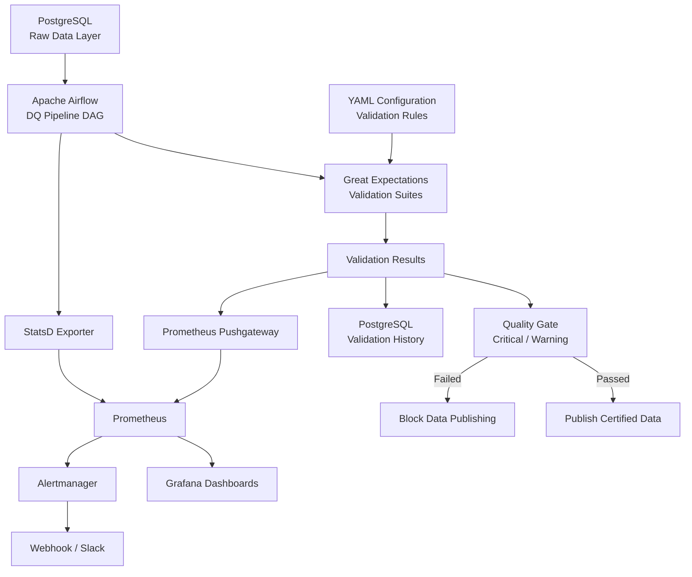

# Data Quality & Pipeline Observability Platform

**An automated data quality validation and pipeline monitoring platform built with Python, Apache Airflow, Great Expectations, PostgreSQL, Prometheus, and Grafana.**

The platform automates data validation across multiple quality dimensions, detects data anomalies, enforces severity-based quality gates, stores historical validation results, and provides monitoring dashboards and alerts.

It is designed to help data engineering teams identify data quality issues early and prevent unreliable data from reaching downstream consumers.

---

## Architecture



### Architecture Workflow

1. **Data Source:** PostgreSQL provides the raw warehouse tables for validation.
2. **Orchestration:** Apache Airflow schedules and coordinates validation workflows.
3. **Validation:** Great Expectations executes validation suites generated from YAML configuration.
4. **Quality Gates:** Validation results are evaluated according to severity levels.
5. **Result Storage:** PostgreSQL stores historical validation results and details of failed records.
6. **Metrics Collection:** Prometheus collects data quality and Airflow execution metrics.
7. **Observability:** Grafana visualizes pipeline health and data quality metrics.
8. **Alerting:** Alertmanager sends alerts for critical quality failures and pipeline issues.

---

## Key Features

### 1. Automated Data Quality Validation

Implements seven data quality dimensions:

| Dimension | Validation |
|---|---|
| Completeness | Detects missing and NULL values |
| Uniqueness | Identifies duplicate records and duplicate combinations |
| Validity | Checks regex patterns, allowed values, and numeric ranges |
| Consistency | Validates schema structure and data types |
| Referential Integrity | Detects orphan records and invalid foreign-key relationships |
| Freshness | Identifies stale data using configurable age thresholds |
| Volume | Detects unexpected changes in record counts |

### 2. Configuration-Driven Validation

Uses YAML-based configuration to define validation rules without modifying the core validation logic.

Example:

```yaml
orders:
  checks:
    - type: between
      column: order_total
      min: 0
      max: 1000000
      severity: critical

    - type: referential
      column: customer_id
      ref_table: customers
      ref_column: customer_id
```

The platform builds validation suites dynamically using the configured rules.

### 3. Severity-Based Quality Gates

Each validation rule supports severity levels:

- **Critical:** Fails the Airflow task and prevents certified data publishing.
- **Warning:** Records the issue and exposes it through monitoring and alerting without blocking publishing.

For failed checks, the platform stores offending record identifiers and samples of invalid values.

### 4. Workflow Orchestration with Apache Airflow

- Schedules recurring data validation workflows.
- Creates validation tasks for configured tables.
- Summarizes validation results.
- Enforces quality gates before publishing.
- Supports retries and repeatable execution.

### 5. Pipeline Monitoring and Observability

Integrates Prometheus and Grafana to monitor:

- Data quality pass rates.
- Failed validation checks.
- Critical quality failures.
- Data freshness.
- Validation execution duration.
- Airflow DAG and task execution metrics.
- Scheduler health.

### 6. Automated Alerting

Uses Prometheus alert rules and Alertmanager to identify:

- Critical data quality failures.
- Data freshness breaches.
- Validation pass rates below configured thresholds.
- Stale validation results.
- Missing metrics.
- Airflow task failures.
- Scheduler heartbeat failures.
- Unavailable monitoring targets.

---

## Technology Stack

| Category | Technologies |
|---|---|
| Programming | Python |
| Workflow Orchestration | Apache Airflow |
| Data Quality | Great Expectations |
| Database | PostgreSQL |
| Monitoring | Prometheus |
| Visualization | Grafana |
| Alerting | Alertmanager |
| Metrics Collection | Pushgateway, StatsD Exporter |
| Configuration | YAML |
| Containerization | Docker, Docker Compose |
| Testing | Pytest |

---

## Repository Structure

```text
Data-Quality-and-Pipeline-Observability-Platform/
│
├── config/
│   └── expectations.yaml
│
├── dags/
│   ├── dq_pipeline.py
│   └── dq_load_demo_data.py
│
├── docker/
│
├── dq_platform/
│   ├── suite_builder
│   ├── runner
│   ├── store
│   ├── metrics
│   └── cli
│
├── monitoring/
│   ├── prometheus/
│   ├── alertmanager/
│   └── grafana/
│
├── scripts/
│   └── seed_data.py
│
├── sql/
│
├── tests/
│
├── docker-compose.yml
├── requirements.txt
├── requirements-dev.txt
├── Makefile
└── README.md
```

---

## Getting Started

### Prerequisites

Ensure the following tools are installed:

- Docker
- Docker Compose
- Git
- Make

### 1. Clone the Repository

```bash
git clone https://github.com/velmurugan27s/Data-Quality-and-Pipeline-Observability-Platform.git

cd Data-Quality-and-Pipeline-Observability-Platform
```

### 2. Start the Platform

```bash
make up
```

This builds the Airflow image and starts the Docker Compose services.

### 3. Load Demo Data

```bash
make seed-dirty
```

This loads sample data containing intentional quality issues.

### 4. Execute the Validation Pipeline

```bash
make run
```

Alternatively, the DAG is configured to run every 10 minutes.

---

## Accessing the Services

Once the containers are running, access the following interfaces:

| Service | URL | Default Local Credentials |
|---|---|---|
| Airflow | http://localhost:8080 | admin / admin |
| Grafana | http://localhost:3000 | admin / admin |
| Prometheus | http://localhost:9090 | — |
| Alertmanager | http://localhost:9093 | — |

**Note:** Default credentials are intended only for local development. Change them before exposing services outside your local environment.

---

## Testing Different Data Quality Scenarios

The project includes multiple demo scenarios to simulate real-world data quality problems.

| Scenario | Command | Expected Behavior |
|---|---|---|
| Clean Data | `make seed-clean` | All checks pass |
| Dirty Data | `make seed-dirty` | Detects duplicates, NULLs, invalid values, and orphan records |
| Stale Data | `make seed-stale` | Detects freshness violations |
| Schema Drift | `make seed-drift` | Detects unexpected schema and data-type changes |

After loading a scenario, execute:

```bash
make run
```

For failing scenarios, the quality gate prevents `publish_certified_data` from executing. The failed checks are visible in Grafana, and configured Prometheus alerts are triggered.

---

## Prometheus Metrics

The platform exposes metrics for tracking data quality and pipeline health.

Examples include:

| Metric | Purpose |
|---|---|
| `dq_table_pass_rate` | Data quality pass rate per table |
| `dq_table_status` | Current table validation status |
| `dq_failed_checks` | Failed checks by dimension and severity |
| `dq_freshness_age_hours` | Age of the latest data |
| `dq_table_rows` | Number of rows in a table |
| `dq_validation_duration_seconds` | Validation execution duration |
| `dq_pipeline_pass_rate` | Overall pipeline pass rate |
| `dq_pipeline_critical_failed_checks` | Critical failures across the pipeline |

Airflow execution metrics are also collected through StatsD and Prometheus.

---

## Running Tests

Install development dependencies:

```bash
pip install -r requirements-dev.txt
```

Run unit tests:

```bash
pytest
```

Run PostgreSQL integration tests:

```bash
DQ_TEST_URL=postgresql+psycopg2://user:pw@localhost:5432/warehouse pytest
```

Run validation through the CLI:

```bash
python -m scripts.seed_data --scenario dirty

python -m dq_platform.cli run --table all
```

### CLI Exit Codes

| Exit Code | Meaning |
|---|---|
| `0` | Validation successful |
| `1` | Critical data quality failure |
| `2` | Infrastructure error |

---

## Engineering Design Decisions

**Configuration-driven validation:** Validation rules are maintained in YAML, making it easier to introduce new checks without changing the core validation implementation.

**Isolated Great Expectations environment:** Great Expectations runs inside a dedicated virtual environment in the Airflow image to avoid dependency conflicts with Airflow packages.

**Prometheus Pushgateway:** Used for short-lived validation tasks so their metrics remain available for Prometheus scraping.

**PostgreSQL and Prometheus:** PostgreSQL stores detailed validation results and failed record information, while Prometheus provides time-series monitoring and alerting.

**Idempotent execution:** Re-running a validation task replaces that table's results for the current run, supporting repeatable Airflow retries.

**Scaling consideration:** The current implementation loads tables into pandas, which is suitable for datasets up to a few million rows. Larger workloads can be supported by moving to a Great Expectations SQL datasource or sampling and partitioning strategies.

---

## What I Learned

Through this project, I gained practical experience with:

- Designing automated data quality validation workflows.
- Orchestrating data validation using Apache Airflow.
- Building configuration-driven validation systems.
- Implementing severity-based data quality gates.
- Storing historical validation results in PostgreSQL.
- Monitoring data quality and pipeline health using Prometheus and Grafana.
- Configuring automated alerts for data and infrastructure failures.
- Containerizing and running multi-service applications using Docker Compose.

---

## Project Links

**GitHub Repository:**  
https://github.com/velmurugan27s/Data-Quality-and-Pipeline-Observability-Platform

---

**Author:** Velmurugan S.  
**Focus:** Data Engineering | Data Quality | Pipeline Observability

If you find this project useful, feel free to explore the repository and share your feedback.
